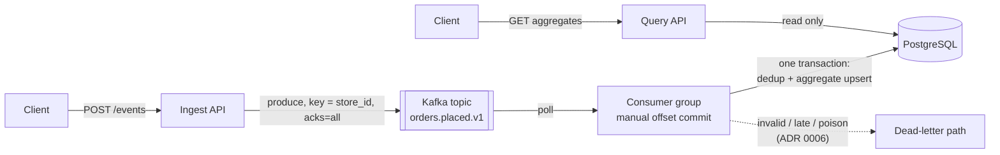

# Architecture

This is the **target** design. Ingest, the consumer, the aggregates, the query API and the
late-event policy are built (phases 1–4); the [component table](#components) says which phase
builds each part. Decisions are recorded in [ADRs](adr/README.md).

The broker is Apache Kafka 4.3.2 in KRaft mode, used through `confluent-kafka`; the consumer and
the database access are synchronous ([ADR 0002](adr/0002-broker-and-client-stack.md)).

## Data flow



- The **topic** is the durable input log. An event exists once the broker has acknowledged it.
- **PostgreSQL** is the source of truth for aggregates. The query API reads only PostgreSQL, never
  the topic.
- Events are partitioned by `store_id`, so one store's events are consumed in order. There is no
  order across stores ([ADR 0001](adr/0001-event-contract.md), decision 5).
- The dead-letter path is a PostgreSQL table, `dead_letters`, keyed by topic position (ADR 0006).

## Guarantees this design aims for

- **At-least-once delivery.** The same event can reach the consumer more than once: a client
  retry, a producer retry, a consumer crash or a rebalance. A duplicate `event_id` never changes an
  aggregate twice; one reused for different content is detected and logged, and the first applied
  copy stays counted (ADR 0004, decision 13).
- **The ingest API reports only what it observed.** It answers `202 Accepted` only after the broker
  confirmed the write with `acks=all` (ADR 0003).
- **The offset follows the database.** A consumer commits an event's offset only after the
  database transaction holding that event's effect has committed (ADR 0004).
- **Event time decides the window.** Windows come from `occurred_at`, not from when the event was
  processed (ADR 0001; the late-event policy is ADR 0005).
- **A poison event does not block its partition.** It goes to the dead-letter path with a reason
  code, and the offset moves on (ADR 0006).

Each becomes a claim only when a test proves it. So far:

- At-least-once with deduplication, and the offset following the database: demonstrated against
  real Kafka and PostgreSQL in phase 3 (`tests/integration/test_aggregation.py`,
  `tests/integration/test_consumer.py`, including a redelivery after crash point B). Restarts in
  phase 5: a stop mid-stream, crash point A, a new group re-reading the topic
  (`tests/integration/test_consumer.py`); and a rebalance, a second consumer joining and the first
  leaving while events arrive (`tests/integration/test_rebalance.py`). A reused `event_id` with
  different content: phase 5 (`tests/unit/test_fingerprint.py`,
  `tests/integration/test_aggregation.py`, `tests/integration/test_consumer.py`).
- Ingest reporting only what it observed: phase 2 (`tests/api/test_events.py`,
  `tests/integration/test_ingest_api.py`).
- Event time decides the window, and late or future events do not count: phases 1 and 4
  (`tests/unit/test_windows.py`, `tests/unit/test_lateness.py`, the consumer tests).
- Poison events: phase 6. Invalid, late, future and unstamped messages, conflicting duplicates and
  events the database rejects (SQLSTATE class 22 or 23) are dead-lettered before their offset moves
  on, and the next message on the partition is processed; a transient database error is retried,
  then stops the consumer without committing (`tests/unit/test_consumer_loop.py`,
  `tests/unit/test_db_errors.py`, `tests/integration/test_consumer.py`). Replay is not built yet.

## Consume, apply, commit

The consumer handles each event in the order below. The crash points show why deduplication and
the order of the two commits are both needed.

```mermaid
sequenceDiagram
    participant K as Kafka
    participant C as Consumer
    participant DB as PostgreSQL

    C->>K: poll
    K-->>C: event (partition p, offset n)
    C->>C: validate envelope and payload
    C->>C: classify by received_at (ADR 0005)
    Note over C: invalid, late, future or no valid received_at: INSERT dead_letters ON CONFLICT DO NOTHING, COMMIT, log, commit offset n + 1 (ADR 0006)
    C->>DB: BEGIN
    C->>DB: INSERT processed_events (event_id, body_sha256) ON CONFLICT DO NOTHING
    alt inserted (first time)
        C->>DB: upsert aggregate (store_id, currency, window_start)
    else conflict (duplicate)
        C->>DB: SELECT the stored body_sha256
        C->>C: skip the aggregate update; a different fingerprint is a conflicting_duplicate
    end
    Note over C: crash point A (anywhere before COMMIT)
    C->>DB: COMMIT
    Note over C: database error, rolled back: class 22/23 is a database_rejected dead letter; any other is retried up to DB_APPLY_ATTEMPTS, then the consumer stops without committing
    Note over C: conflicting_duplicate: dead letter in its own transaction, as above
    Note over C: crash point B
    C->>K: commit offset n + 1 for partition p
    Note over C: crash point C
```

| Crash at | State after the crash | What happens on restart | Why the aggregate stays correct |
|----------|-----------------------|-------------------------|---------------------------------|
| A (anywhere before `COMMIT`) | Nothing was committed; an open transaction is discarded by PostgreSQL. The offset is not committed. | Kafka redelivers the event from the last committed offset. | Nothing was applied, so it is applied once now. |
| B (after `COMMIT`, before the offset commit) | The effect is in PostgreSQL. The offset is not committed. | Kafka redelivers the event. | The `processed_events` insert conflicts, so the aggregate is not updated again. |
| C (after the offset commit) | Both are committed. | The event is not redelivered. | Nothing to do. |
| After a dead letter's `COMMIT`, before the offset commit | The dead letter is stored. The offset is not committed. | Kafka redelivers the message. | It is classified the same way, and its dead letter conflicts on the position (topic, partition, offset), so it is stored once. |

Crash point B is the reason the pipeline needs deduplication even without client retries: the two
commits go to two different systems and cannot be atomic. The alternative, storing offsets in
PostgreSQL in the same transaction, is compared in ADR 0004.

The same reasoning applies at ingest. If the API crashes after the broker acknowledged an event
but before it answered the client, the client retries with the same `event_id`, the topic holds
the event twice, and deduplication in the consumer absorbs it.

The diagram shows one offset commit per event, synchronous, as ADR 0004 decided. A rebalance can
refuse that offset commit; the consumer logs it and goes on (ADR 0004, decision 10). The event's
effect is already in PostgreSQL, so this is crash point B without the crash: if the partition moves,
its new owner redelivers the event and the `processed_events` insert absorbs it. Nothing is
committed when partitions are revoked: that happens only inside `poll`, and the loop never polls
between an event's two commits (decision 11).

## Components

The package is `src/event_pipeline/`. The layer rules: only `services/` opens and commits database
transactions; `domain/` does no I/O; routers and the consumer loop call services and contain no
business rules.

| Component | Responsibility | Built in phase | Status |
|-----------|----------------|----------------|--------|
| `domain/` | Event envelope and payload schemas, error codes, window assignment | 1 | Built |
| Kafka in Docker Compose (`make up`, `make topics`) | Local broker; topic declared explicitly, auto-create off | 2 | Built |
| `broker/` producer, ingest API (`POST /events`) | Validate, produce with `acks=all`, answer after the broker acknowledged | 2 | Built |
| `/health`, `/ready` | Liveness; readiness of the broker, the topic, the producer's poll thread, and the database at the expected migration revision (own readiness engine, each check bounded) | 2, 3 | Built |
| PostgreSQL in Docker Compose (`make up`) | Local database and the `_test` database for integration tests | 3 | Built |
| `data/` tables and migrations | `order_aggregates` and `processed_events`; Alembic revision 0001 with CHECKs from the contract, 0002 adds each event's fingerprint, 0003 the `dead_letters` table (`make db-migrate`) | 3, 5, 6 | Built |
| `services/` apply (`apply_order_placed`) | Deduplicate by `event_id` and upsert the aggregate in one transaction; a duplicate changes nothing, one with a different fingerprint is reported as a conflicting duplicate; any database error rolls back both | 3, 5 | Built |
| `consumer/` (`make consumer`) | Poll loop; offset committed synchronously after the apply transaction; a message that is not counted is dead-lettered first (ADR 0006); a transient database error is retried up to `DB_APPLY_ATTEMPTS` times; any other failure stops the process without committing; SIGTERM finishes the current event | 3, 6 | Built |
| Query API (`GET /stores/{store_id}/aggregates`) | Read a store's aggregates in `[from, to)` from PostgreSQL only; parameters validated with the contract's rules and reason codes | 3 | Built |
| Late-event policy (`domain/lateness.py`) | An event counts only if `received_at − occurred_at` ≤ `ALLOWED_LATENESS_S`; the consumer skips late, future and unstamped events (dead-lettered and logged, offset committed); ingest rejects events from the future (ADR 0005) | 4 | Built |
| Restart and rebalance handling | Restart resumes at the committed offset (tested); `cooperative-sticky` assignment; an offset commit refused by a membership change is a WARNING, not a failure; assignments and revocations logged (ADR 0004, decisions 9-12) | 5 | Built |
| Dead-letter path and replay | `dead_letters` table, written before the offset commit for invalid, late, future, unstamped, conflicting and database-rejected messages; transient database errors retried in place (`data/errors.py` classifies by SQLSTATE) (built); replay (not built yet) | 6 | Partly built |
| Failure tests | Process kill, database down, broker down | 7 | Not built |
| Guarantee and limitation docs, measurements | Written guarantees and a repeatable measurement script | 8 | Not built |
