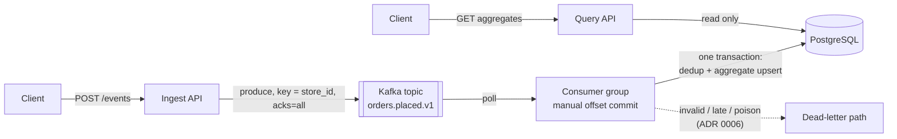
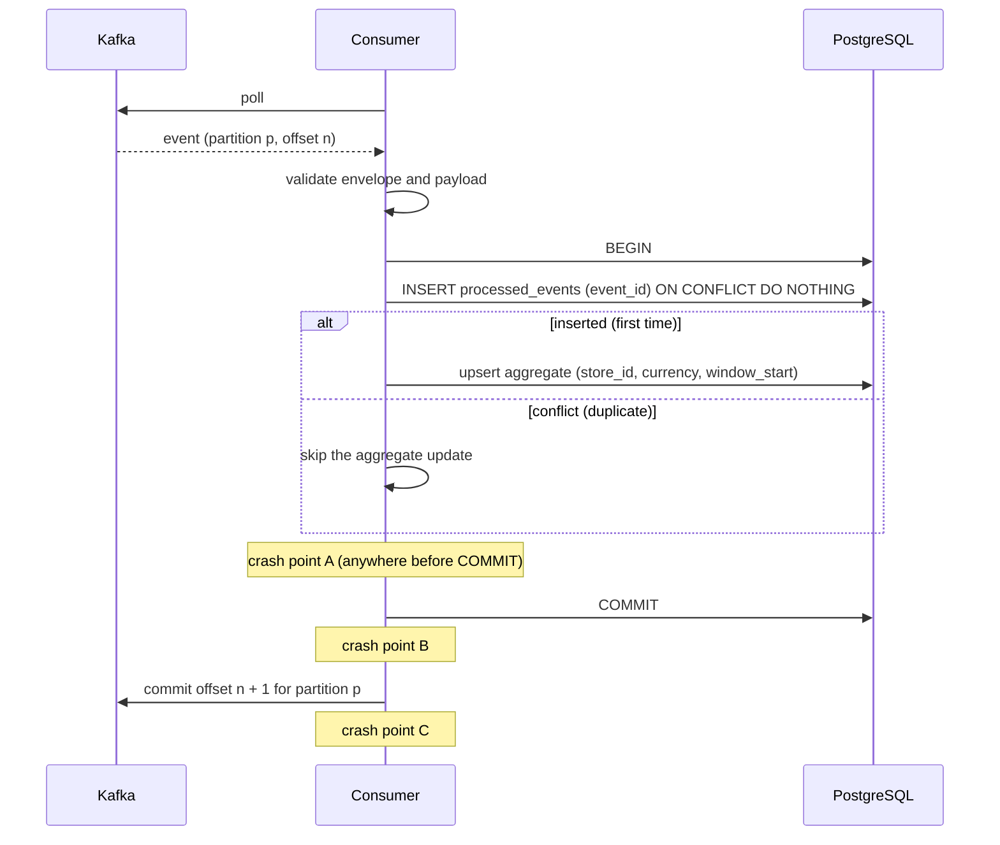

# Architecture

This is the **target** design. Only the ingest side is built so far; the
[component table](#components) says which phase builds each part. Decisions are recorded in [ADRs](adr/README.md).

The broker is Apache Kafka 4.3.2 in KRaft mode, used through `confluent-kafka`; the consumer and
the database access are synchronous ([ADR 0002](adr/0002-broker-and-client-stack.md)).

## Data flow

- The **topic** is the durable input log. An event exists once the broker has acknowledged it.
- **PostgreSQL** is the source of truth for aggregates. The query API reads only PostgreSQL, never
  the topic.
- Events are partitioned by `store_id`, so one store's events are consumed in order. There is no
  order across stores ([ADR 0001](adr/0001-event-contract.md), decision 5).
- The dead-letter path (a topic or a table) and its reason codes are decided in ADR 0006.

## Guarantees this design aims for

- **At-least-once delivery.** The same event can reach the consumer more than once: a client
  retry, a producer retry, a consumer crash or a rebalance. A duplicate `event_id` never changes an
  aggregate twice.
- **The ingest API reports only what it observed.** It answers `202 Accepted` only after the broker
  confirmed the write with `acks=all` (ADR 0003).
- **The offset follows the database.** A consumer commits an event's offset only after the
  database transaction holding that event's effect has committed (ADR 0004).
- **Event time decides the window.** Windows come from `occurred_at`, not from when the event was
  processed (ADR 0001; the late-event policy is ADR 0005).
- **A poison event does not block its partition.** It goes to the dead-letter path with a reason
  code, and the offset moves on (ADR 0006).

None of these is demonstrated yet. Each one becomes a claim only when the phase that builds it has
a test proving it.

## Consume, apply, commit

The consumer handles each event in the order below. The crash points show why deduplication and
the order of the two commits are both needed.

| Crash at | State after the crash | What happens on restart | Why the aggregate stays correct |
|----------|-----------------------|-------------------------|---------------------------------|
| A (anywhere before `COMMIT`) | Nothing was committed; an open transaction is discarded by PostgreSQL. The offset is not committed. | Kafka redelivers the event from the last committed offset. | Nothing was applied, so it is applied once now. |
| B (after `COMMIT`, before the offset commit) | The effect is in PostgreSQL. The offset is not committed. | Kafka redelivers the event. | The `processed_events` insert conflicts, so the aggregate is not updated again. |
| C (after the offset commit) | Both are committed. | The event is not redelivered. | Nothing to do. |

Crash point B is the reason the pipeline needs deduplication even without client retries: the two
commits go to two different systems and cannot be atomic. The alternative, storing offsets in
PostgreSQL in the same transaction, is compared in ADR 0004.

The same reasoning applies at ingest. If the API crashes after the broker acknowledged an event
but before it answered the client, the client retries with the same `event_id`, the topic holds
the event twice, and deduplication in the consumer absorbs it.

The diagram shows one offset commit per event. Whether offsets are committed per event or per
batch, and what happens on a rebalance, is decided in ADR 0004 and tested in phase 5.

## Components

The package is `src/event_pipeline/`. The layer rules: only `services/` opens and commits database
transactions; `domain/` does no I/O; routers and the consumer loop call services and contain no
business rules.

| Component | Responsibility | Built in phase | Status |
|-----------|----------------|----------------|--------|
| `domain/` | Event envelope and payload schemas, error codes, window assignment | 1 | Built |
| Kafka in Docker Compose (`make up`, `make topics`) | Local broker; topic declared explicitly, auto-create off | 2 | Built |
| `broker/` producer, ingest API (`POST /events`) | Validate, produce with `acks=all`, answer after the broker acknowledged | 2 | Built |
| `/health`, `/ready` | Liveness; readiness of the broker, the topic and the producer's poll thread | 2 | Built (database and migration checks in phase 3) |
| PostgreSQL in Docker Compose (`make up`) | Local database and the `_test` database for integration tests | 3 | Built |
| `data/` tables and migrations | `order_aggregates` and `processed_events`; Alembic revision 0001 with CHECKs from the contract (`make db-migrate`) | 3 | Built |
| `services/` apply | Deduplicate and upsert the aggregate in one transaction | 3 | Not built |
| `consumer/` | Poll loop, manual offset commit, shutdown | 3 | Not built |
| Query API | Read aggregates from PostgreSQL | 3 | Not built |
| Late-event policy | Watermark and allowed lateness | 4 | Not built |
| Restart and rebalance handling | Offset behaviour on restart, commit on partition revoke | 5 | Not built |
| Dead-letter path and replay | Route poison and late events with a reason code; replay procedure | 6 | Not built |
| Failure tests | Process kill, database down, broker down | 7 | Not built |
| Guarantee and limitation docs, measurements | Written guarantees and a repeatable measurement script | 8 | Not built |
